## 链式梯度


图像分类 f(x,w)=wx+b 

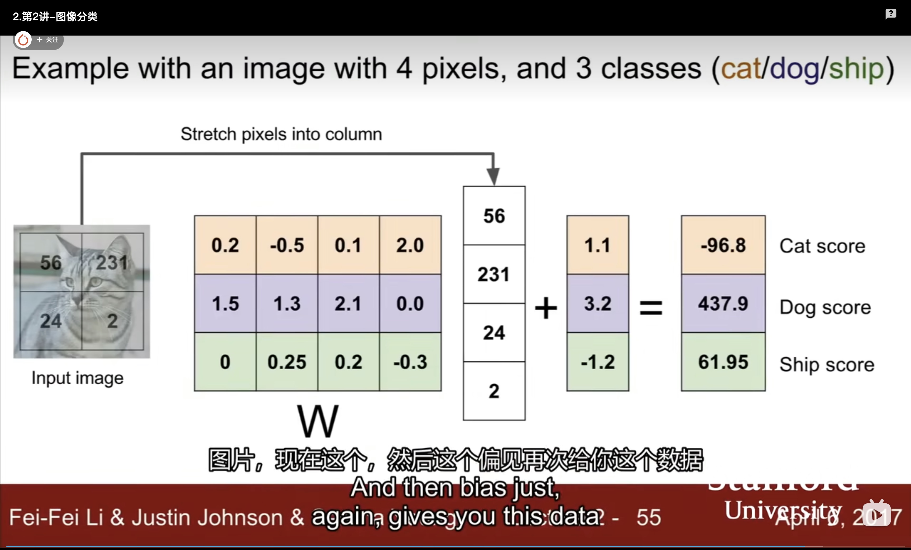

损失函数计算

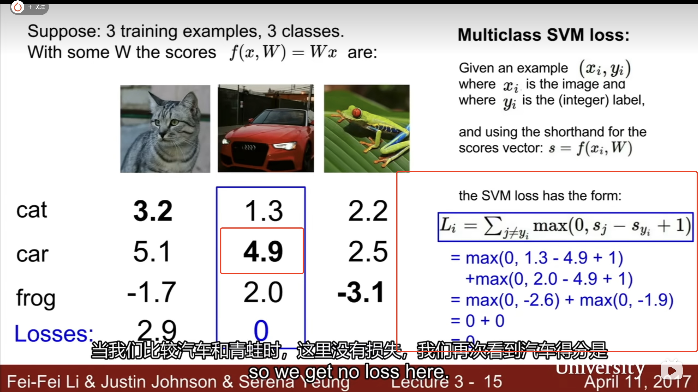

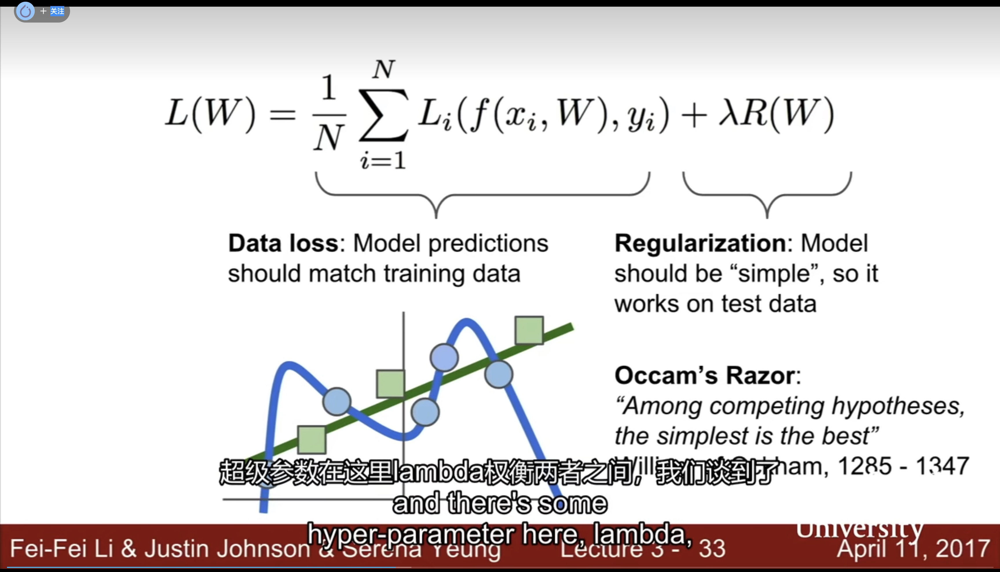

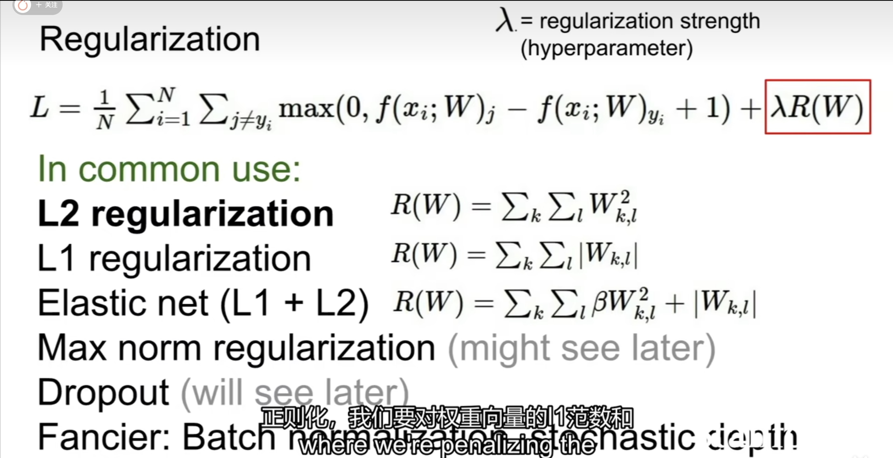

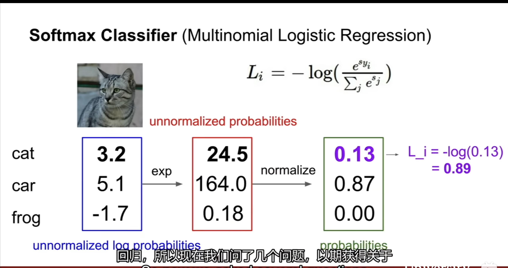

一个一个参数的调整w，计算梯度，太慢 )

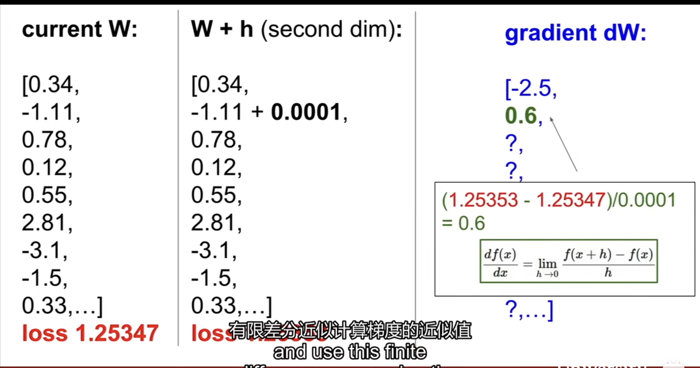

新计算梯度)

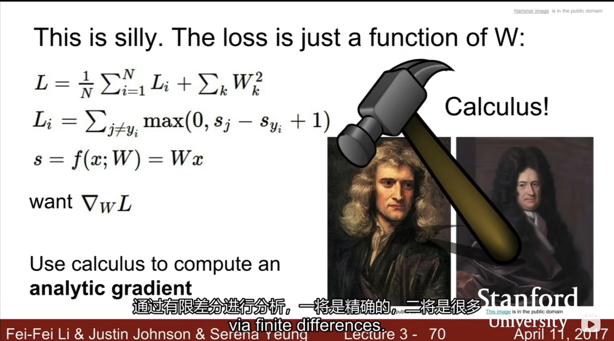

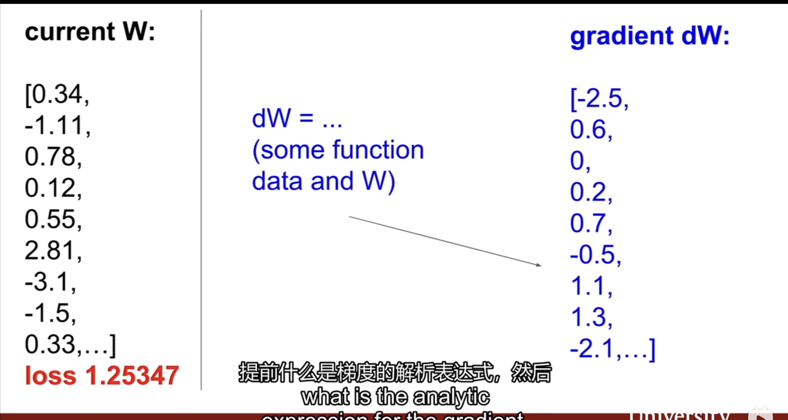

反向梯度

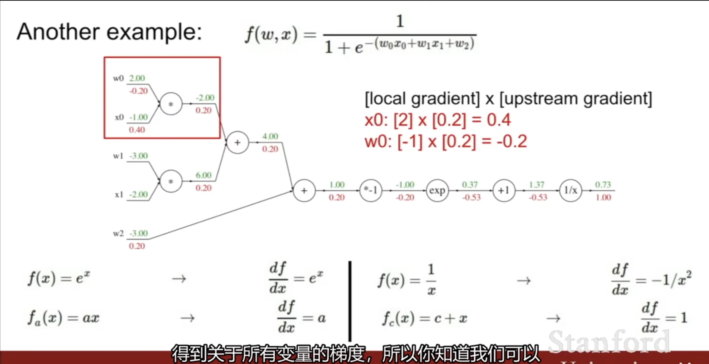

矩阵

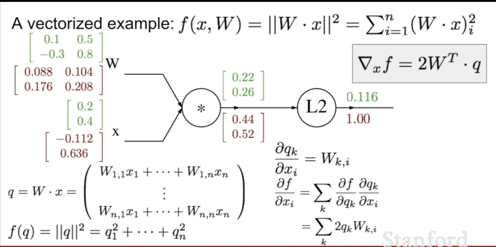

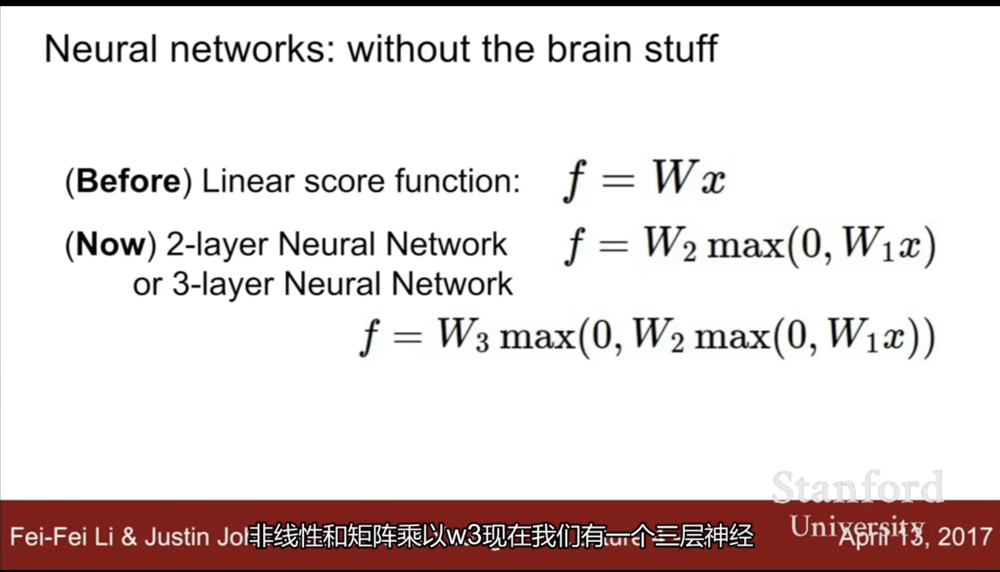

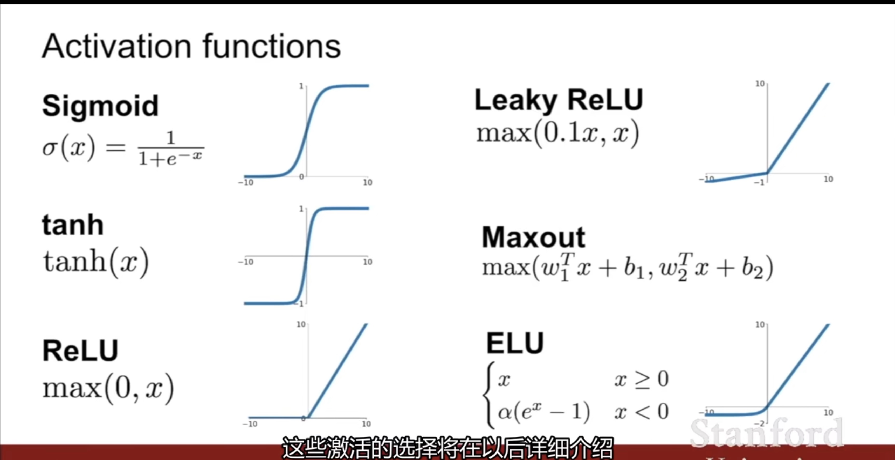

反向传播

1. 一个输入，会产生多个输出，每个输出，都会期待前一层的梯度变化，然后汇总计算一个值

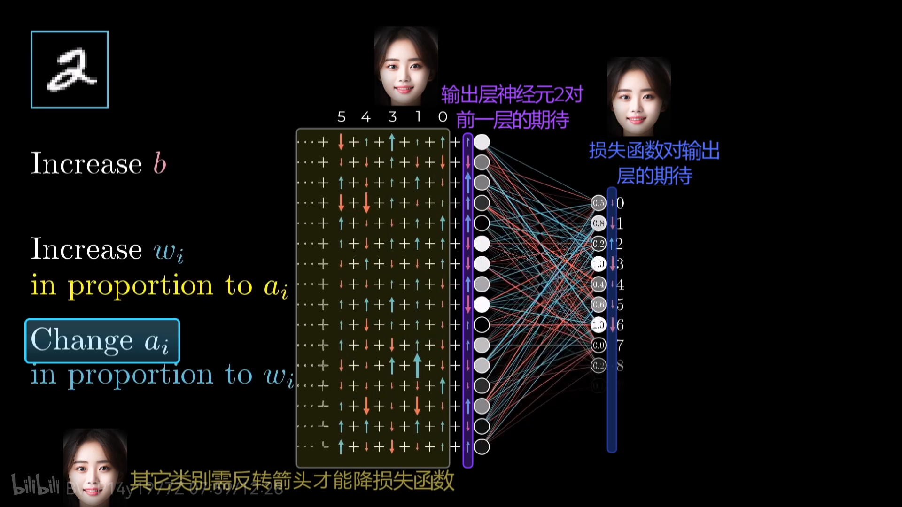

2. 多个输入计算对一个w的平均值
3. 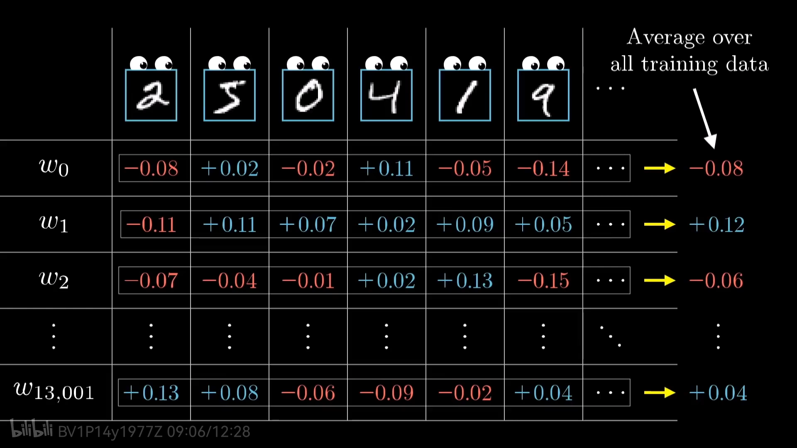
4. 将一批数据分成多个批次，一个批次有多个数据，(随机梯度的随机含义)

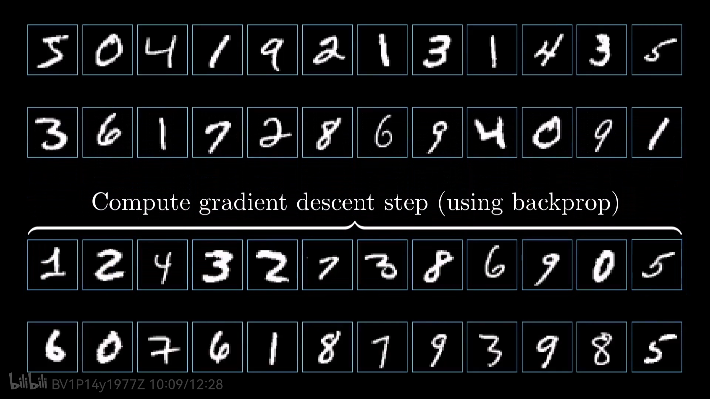


## 简单两层模型


O是激活函数，sigmod

第一层 z2 = O(w1x+b1)

第二层 z1 = O(w2(z2) + b2)

损失函数 (z1-y)^2 / 2

***

第二层梯度  
delta_b2 = (z1-y)* sigmoid_prime  
delta_w2 = delta_b2 * z2

第一层梯度  
delta_b1 = delta_w2 * w2  * sigmoid_prime  
delta_w1 = x * delta_b1

### 损失函数

1. 二次损失函数 quadratic cost function

       1. (z-y)^2

       2. 梯度变化越来越小，变化不明显

2. 交叉商损失函数 cross-entropy cost function

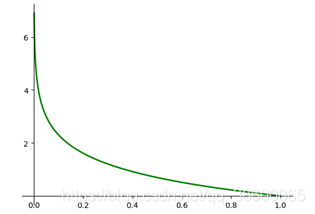


            


## 激活函数

### softmax


## CNN


## RNN


word2vec 每个词使用一个50维的向量表示，

通过训练，同时更新 w, x (普通模型只更新w), 训练是通过输入两个词，输出是相似度


### text-CNN


LSTM

遗忘门，输入门，输出门


## GAN 对抗生成网络


## attention 自注意模型q, k, v

q 问题，维度和k 一样。query

k 参数,keys

v 答案,values

如果，q,k, v 是一样的，那就是自注意模型

t = q·k 计算q和所有k的相关度

t · v 挑选相关度里最相关的内容


## input embeding


encoding


多层


decode is auto regressive 自回归的(输出作为下一次的输入)


decode 计算attention和encode区别是，decode层attention 前面的词时不考虑后面的词


## GNN 图深度学习 GCN


1. 消息传递
2. 消息聚合


全链接层来做神经元数量变化，512-> 256

每一层的多个输入做求和平均操作，输入运算层


加入自引用，听到自己的声音


# loss function 

## CrossEntropyLoss

nn.CrossEntropyLoss()计算得到的结果与softmax-log-NLLLoss计算得到的结果是一致的。

```python
import torch
import torch.nn as nn
x_input=torch.randn(3,3)#随机生成输入 
print('x_input:\n',x_input) 
y_target=torch.tensor([1,2,0])#设置输出具体值 print('y_target\n',y_target)

#计算输入softmax，此时可以看到每一行加到一起结果都是1
softmax_func=nn.Softmax(dim=1)
soft_output=softmax_func(x_input)
print('soft_output:\n',soft_output)

#在softmax的基础上取log
log_output=torch.log(soft_output)
print('log_output:\n',log_output)

#对比softmax与log的结合与nn.LogSoftmaxloss(负对数似然损失)的输出结果，发现两者是一致的。
logsoftmax_func=nn.LogSoftmax(dim=1)
logsoftmax_output=logsoftmax_func(x_input)
print('logsoftmax_output:\n',logsoftmax_output)

#pytorch中关于NLLLoss的默认参数配置为：reducetion=True、size_average=True
nllloss_func=nn.NLLLoss()
nlloss_output=nllloss_func(logsoftmax_output,y_target)
print('nlloss_output:\n',nlloss_output)

#直接使用pytorch中的loss_func=nn.CrossEntropyLoss()看与经过NLLLoss的计算是不是一样
crossentropyloss=nn.CrossEntropyLoss()
crossentropyloss_output=crossentropyloss(x_input,y_target)
print('crossentropyloss_output:\n',crossentropyloss_output)
```

> nn.LogSoftmax ==  torch.log(nn.Softmax())
> 
> nn.CrossEntropyLoss == nn.NLLLoss(nn.LogSoftmax())


## BCELoss


## BCEWithLogitsLoss

> ````
> m = nn.Sigmoid()
> weight = torch.tensor([0.8])
> loss_fct = nn.BCELoss(reduction="mean", weight=weight)
> loss_fct_logit = nn.BCEWithLogitsLoss(reduction="mean", weight=weight)
> input_src = torch.Tensor([0.8, 0.9, 0.3])
> target = torch.Tensor([1, 1, 0])
> print(input_src)
> print(target)
> output = m(input_src)
> loss = loss_fct(output, target)
> loss_logit = loss_fct_logit(input_src, target)
> print(loss.item())
> print(loss_logit.item())
> # 结果一致
> 
> tensor([0.8000, 0.9000, 0.3000])
> tensor([1., 1., 0.])
> 0.4177626371383667
> 0.4177626371383667
> ````


# dropout

nn.Dropout

> **一句话总结：Dropout的是为了防止过拟合而设置**
> 
> **详解部分：**1.Dropout是为了防止过拟合而设置的  
2.Dropout顾名思义有丢掉的意思  
3.nn.Dropout(p = 0.3) # 表示每个神经元有0.3的可能性不被激活  
4.Dropout只能用在训练部分而不能用在测试部分  
5.Dropout一般用在全连接神经网络映射层之后，如代码的nn.Linear(20, 30)之后
> 
> ### 如果处于model.eval模式时，并不会使用Dropout


###  LoRA low rank adaption 低秩适配

核心是矩阵降维，将一个大的矩阵，使用多个小矩阵表示

> (3, 1) * (1, 3) = (3, 3)  
> 
> 参数大小： 2**3 < 3* * 3
> 
> 2*1000 <<< 1000 * 1000


## max,argmax

> max: 返回最大值在该维度上的值和位置索引
> 
> argmax: 返回输入张量中指定维度的[最大值](https://so.csdn.net/so/search?q=%25E6%259C%2580%25E5%25A4%25A7%25E5%2580%25BC&spm=1001.2101.3001.7020)的索引
> 
> min:
> 
> argmin: